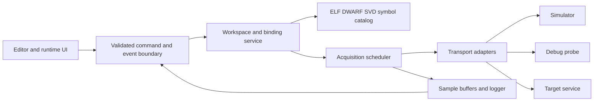

# Architecture proposal

This is a proposed design, not the internal architecture of µC/Probe.

## Stack decision

Default: Tauri 2 desktop shell, Rust backend, TypeScript/React UI. Use SVG for reusable instruments and editor geometry, Canvas for dense chart traces, normal DOM for inspectors and accessible controls. Rust suits binary parsers, bounded protocol handling and probe-rs integration; web rendering supports original vector components and a browser-testable offline demo. Tauri's documented cross-platform shell makes this a plausible route, not proof of real-time rendering or USB behavior. [Tauri](https://v2.tauri.app/)

Alternative: Qt 6/C++/QML if native deployment, existing C++ expertise or measured WebView limitations dominate. Electron if Node-centric delivery speed outweighs package size. Avoid maintaining multiple desktop shells. M0 must prove the chosen stack on Windows before building the hardware features. Evaluate dependency licenses and installer prerequisites; pin versions after that proof.

## Boundaries

Proposed directory boundaries: `apps/desktop/` frontend and Tauri glue; `crates/model/` workspace and types; `crates/symbols/`; `crates/acquisition/`; `crates/transports/`; `crates/protocol/`; `firmware/` optional C service; `packages/contracts/`; `assets/`; `tests/fixtures/`. Do not create empty application modules and call them implemented.

## Symbol service

Use the `object` crate for object containers and `gimli` for DWARF; these are parsing libraries, not complete variable resolvers. [object](https://docs.rs/object/latest/object/) and [gimli](https://docs.rs/gimli/latest/gimli/). Normalize source identity, compilation unit, linkage name, declared name, type graph, byte/bit offsets, dimensions, endianness and address location. Only accept supported static memory locations at first; reject frame/register-dependent, optimized-out, TLS, ambiguous and unsupported location expressions.

Support DWARF 4/5 with real compiler fixtures first, then 2/3. Walk typedef/const/volatile wrappers, abstract origins/specifications, arrays with explicit lower bounds/strides, enum underlying types, nested structures, packed members and bitfields. Distinguish variable storage from pointed-to content. Do not derive pointer targets from the ELF value or follow pointers indefinitely.

Debounce file-watch changes, parse replacement off-thread, publish a new catalog epoch atomically, rebind by qualified identity/path and validate types. Suspend affected writes during reload. Same name in multiple files is ambiguous and requires user resolution. Build ID/hash should be compared with target identity when available; no comparison means an explicit unverified-firmware state.

## Transport interface

`discover`, `connect(config)`, `capabilities`, `readBlocks`, `writeBlock`, `disconnect`; optional coherent snapshot, scope, terminal and metadata capabilities. Addresses are u64 in Rust and strings at JSON boundaries. Capabilities include address width, max block, alignment, byte order, access while running, halt requirement, masked-write support, snapshot support and sharing model.

MVP adapter: simulator, followed by probe-rs on a deliberately selected target. probe-rs documents probe enumeration and memory reads/writes, but current API and running-core support must be verified for the selected backend/device. Do not copy quickstart halt or flash calls into connect. [probe-rs](https://probe.rs/docs/library/quickstart/)

OpenOCD's Tcl service is an optional adapter behind strict typed commands, not arbitrary frontend command strings. Never expose it to remote clients through this application. J-Link SDK/DLL integration is optional and requires distribution/license review. A shared probe is supported only if that adapter demonstrably supports it. [OpenOCD commands](https://openocd.org/doc/html/General-Commands.html)

## Scheduler and cache

Normalize subscriptions into byte ranges by target/core/epoch/period. Deduplicate same reads; coalesce only ordinary RAM within allowed ranges and block limits. Never coalesce across MMIO, unmapped gaps or read-side-effect registers. Writes serialize with overlapping reads; cache entries invalidated after write. A read completion includes monotonic host start/end and quality; scheduled time must not be substituted for actual time.

Use bounded queues and weighted work budgets for interactive indicators, logging, memory view and scope downloads. Poll producers never block the UI. Reduce rendering frequency without discarding recorded data; if producer exceeds logger capacity, emit an explicit overrun and policy result. Export diagnostics without credentials or firmware bytes by default.

## Session and write correctness

Each connection increments an epoch. Commands carry that epoch and expected catalog revision. Backend checks both immediately before I/O. Stop cancels pending input writes and deactivates repeats/scripts/HID. A write timeout becomes `unknown`, not automatically retried; a readback can verify current value but cannot prove how many times a side-effect operation occurred.

For ordinary RAM, bit RMW is non-atomic relative to firmware. Prefer target-side atomic masked update or clearly label the risk. For SVD registers use their declared semantics (write-one-to-clear, read-clear, reserved bits); ordinary RMW is forbidden where unsafe. [Arm register schema](https://arm-software.github.io/CMSIS_5/5.8.0/SVD/html/elem_registers.html)

## Extension model

Built-in adapters first. Later extensions declare capabilities and run out of process or in a restricted runtime. Target terminal, scripts and HID use the same typed write service. Save secret references rather than credentials. A workspace cannot grant itself filesystem/network/process permissions. Frame ownership and target-side authorization are separate from UI layout locking.
